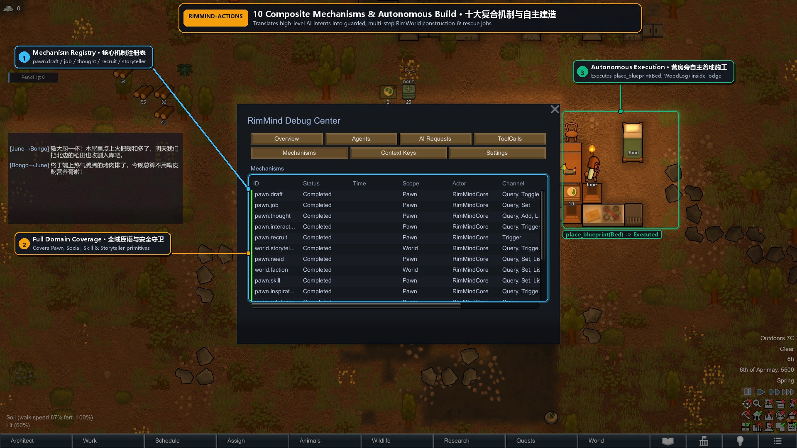
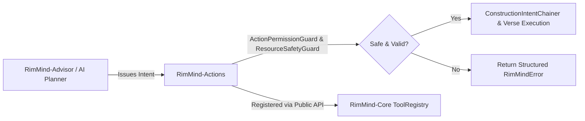

<div align="center">

# RimMind-Actions ⚡
### Composite Mechanisms & Tactical Emergency Actions for RimWorld 1.6 & 1.7

**English** | [简体中文](README_zh.md)

<p>
  <a href="https://rimworldgame.com/"></a>
  <a href="https://github.com/RimWorld-RimMind-Mod/RimWorld-RimMind-Mod-Core"></a>
  <a href="#"></a>
  <a href="LICENSE"></a>
</p>

<p><em>Equip AI-driven colonists with battlefield triage, autonomous construction, farming, and tactical emergency mechanisms.</em></p>

</div>

---

## 📖 Overview

**RimMind-Actions** translates high-level AI tactical and colony-building intents into robust, multi-step game actions called **Composite Mechanisms**. When facing sudden crises or executing long-running colony projects, colonists autonomously execute and poll composite workflows to completion.

### Key Highlights
- **11 Built-in Composite Tools**:
  - **Emergency & Survival**: `actions.stabilize_rest`, `actions.emergency_flee`, `actions.eat_and_recreation`, `actions.triage_patient`, `actions_manage_equipment`
  - **Construction & Spatial Query**: `actions_place_blueprint`, `actions_plan_room_project`, `actions_query_buildable_structures`
  - **Production, Zones & Resources**: `actions_designate_resources`, `actions_add_worktable_bill`, `actions_manage_zone`
- **`ConstructionIntentChainer` & Spatial Solver**: Evaluates room topology, peer clustering, and interaction cells via `ColonySpatialClusterSolver`, then attaches continuous `Blueprint_Build` -> `Frame` construction leases through `RimMindAPI.Agent.StartIntentSession`.
- **`ActionPermissionGuard` & `ResourceSafetyGuard`**: Enforces active spawned colonist eligibility, tri-state autonomy permissions, stuffed and fixed material reserve checks, and concurrent blueprint caps before mutating map state.

---

## 🎮 In-Game Showcase


*In-game Mechanisms Registry & Autonomous Execution: Inspecting registered mechanisms while colonists autonomously place and build blueprints beside the colony lodge.*

---

## 🏛️ Dependency & Integration

`RimMind-Actions` depends solely on the public API of `RimMind-Core`:



---

## 🛠️ Installation & Requirements

Ensure `RimMind-Core` is loaded before `RimMind-Actions`:

```text
1. Harmony
2. Core (Vanilla RimWorld)
3. RimMind-Core
4. RimMind-Actions
```

---

## 🧪 Developer Guide & Testing

Run unit tests directly:

```powershell
dotnet test RimMind-Actions/Tests/RimMindActions.Tests.csproj -c Release
```

---

## 📜 License

Licensed under the [MIT License](LICENSE).
