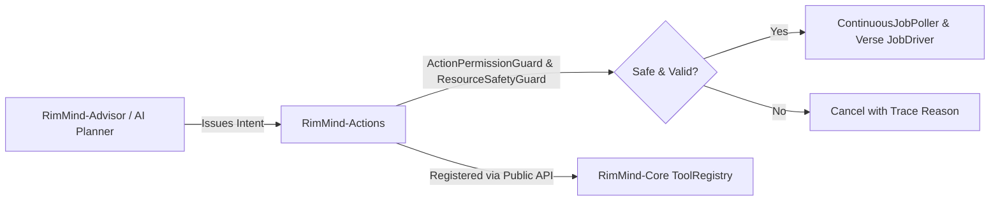

<div align="center">

# RimMind-Actions ⚡
### Composite Mechanisms & Tactical Emergency Actions for RimWorld 1.6

**English** | [简体中文](README_zh.md)

<p>
  <a href="https://rimworldgame.com/"></a>
  <a href="https://github.com/mcocdaa/RimWorld-RimMind-Mod-Core"></a>
  <a href="#"></a>
  <a href="LICENSE"></a>
</p>

<p><em>Equip AI-driven colonists with battlefield triage, autonomous construction, farming, and tactical emergency mechanisms.</em></p>

</div>

---

## 📖 Overview

**RimMind-Actions** translates high-level AI tactical and colony-building intents into robust, multi-step game actions called **Composite Mechanisms**. When facing sudden crises or executing long-running colony projects, colonists autonomously execute and poll composite workflows to completion.

### Key Highlights
- **10 Built-in Composite Tools**:
  - **Emergency & Survival**: `actions.stabilize_rest`, `actions.emergency_flee`, `actions.eat_and_recreation`, `actions.triage_patient`
  - **Construction & Engineering**: `actions.place_blueprint`, `actions.plan_room_project`, `actions.clear_area_for_build`
  - **Production & Agriculture**: `actions.designated_harvest`, `actions.set_work_bill`, `actions.schedule_farming_cycle`
- **`ContinuousJobPoller` Multi-Stage Lifecycle**: Continuously drives multi-step jobs (including seamless `Blueprint_Build` -> `Frame` resource delivery and construction transitions) until every target structure is finished or canceled.
- **`ActionPermissionGuard` & `ResourceSafetyGuard`**: Enforces active spawned non-downed colonist eligibility, work-type capability checks, danger proximity interception, and colony material reserve thresholds before issuing Verse jobs.

---

## 🎮 In-Game Showcase


*In-game Mechanisms Registry & Autonomous Execution: Inspecting all 10 registered mechanisms (`pawn.draft`, `pawn.job`, `pawn.thought`, `pawn.interaction`, `pawn.recruit`, `world.storyteller`, etc.) while colonists execute `place_blueprint(Bed, WoodLog)` beside the colony lodge.*

---

## 🏛️ Dependency & Integration

`RimMind-Actions` depends solely on the public API of `RimMind-Core`:



---

## 🛠️ Installation & Requirements

Ensure `RimMind-Core` is loaded before `RimMind-Actions`:

```text
1. Harmony
2. Core (Vanilla RimWorld)
3. RimMind-Core
4. RimMind-Actions
```

---

## 🧪 Developer Guide & Testing

Run unit tests directly:

```powershell
dotnet test RimMind-Actions/Tests/RimMindActions.Tests.csproj -c Release
```

---

## 📜 License

Licensed under the [MIT License](LICENSE).
