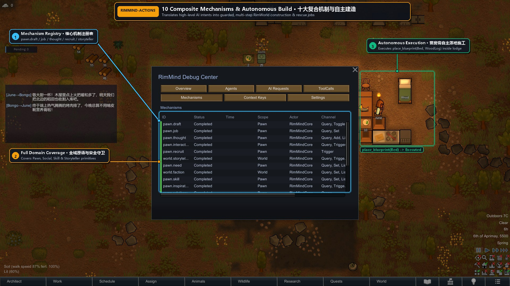
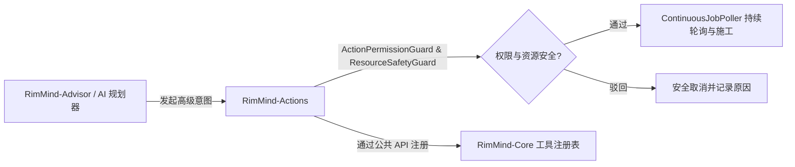

<div align="center">

# RimMind-Actions ⚡
### 专为 RimWorld 1.6 打造的复合机制动作与战地应急自救系统

[English](README.md) | **简体中文**

<p>
  <a href="https://rimworldgame.com/"></a>
  <a href="https://github.com/mcocdaa/RimWorld-RimMind-Mod-Core"></a>
  <a href="#"></a>
  <a href="LICENSE"></a>
</p>

<p><em>为 AI 殖民者赋予战地急救、蓝图建造、农耕排程与自主战术执行能力。</em></p>

</div>

---

## 📖 模块概览

**RimMind-Actions** 负责将大语言模型产生的高级战术与建设意图转化为稳健的多步骤游戏机制动作（**Composite Mechanisms**）。无论是面临战地重伤失血、突发险情，还是执行房间建造与农耕生产，殖民者都能自主发起并持续轮询复合动作直至完工。

### 核心特性
- **10 大内置复合工具**：
  - **生存与战地急救**：`actions.stabilize_rest`、`actions.emergency_flee`、`actions.eat_and_recreation`、`actions.triage_patient`
  - **建筑与工程规划**：`actions.place_blueprint`、`actions.plan_room_project`、`actions.clear_area_for_build`
  - **生产与农耕调度**：`actions.designated_harvest`、`actions.set_work_bill`、`actions.schedule_farming_cycle`
- **`ContinuousJobPoller` 多阶段持续轮询**：全程跟踪多步作业生命周期（包括 `Blueprint_Build` 蓝图转化为 `Frame` 建造框架后的持续运料与施工），直至实体建筑落成或任务取消。
- **`ActionPermissionGuard` 与 `ResourceSafetyGuard` 双重守卫**：严格校验殖民者存活在图且未倒地（`!Downed`）、工作类型能力、危险逼近距离与殖民地物资保底红线。

---

## 🎮 实机特性展示


*战地紧急施救实机场景：AI 殖民者冒着硝烟快速为倒地队友止血，并协作转运至医疗床。*

---

## 🏛️ 依赖关系与设计原则

`RimMind-Actions` 严格单向依赖 `RimMind-Core` 公共 API：



---

## 🛠️ 安装与加载顺序

确保 `RimMind-Core` 位于 `RimMind-Actions` 之前：

```text
1. Harmony
2. Core (RimWorld 原版)
3. RimMind-Core
4. RimMind-Actions
```

---

## 🧪 开发者测试指南

运行单元测试：

```powershell
dotnet test RimMind-Actions/Tests/RimMindActions.Tests.csproj -c Release
```

---

## 📜 开源协议

本项目采用 [MIT License](LICENSE) 开源许可证。
