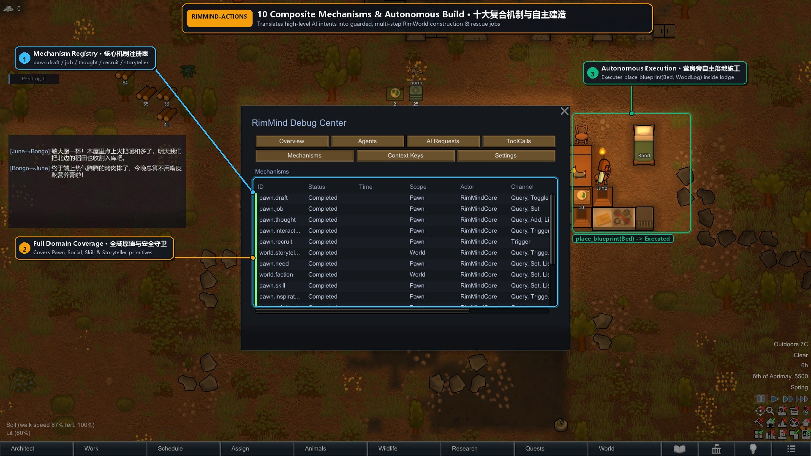
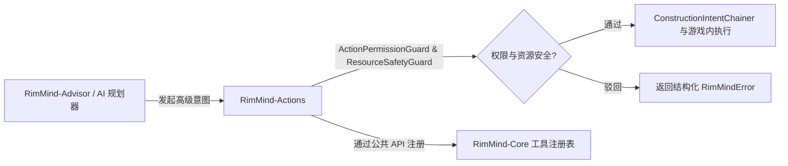

<div align="center">

# RimMind-Actions ⚡
### 专为 RimWorld 1.6 & 1.7 打造的复合机制动作与战地应急自救系统

[English](README.md) | **简体中文**

<p>
  <a href="https://rimworldgame.com/"></a>
  <a href="https://github.com/RimWorld-RimMind-Mod/RimWorld-RimMind-Mod-Core"></a>
  <a href="#"></a>
  <a href="LICENSE"></a>
</p>

<p><em>为 AI 殖民者赋予战地急救、蓝图建造、农耕排程与自主战术执行能力。</em></p>

</div>

---

## 📖 模块概览

**RimMind-Actions** 负责将大语言模型产生的高级战术与建设意图转化为稳健的多步骤游戏机制动作（**Composite Mechanisms**）。无论是面临战地重伤失血、突发险情，还是执行房间建造与农耕生产，殖民者都能自主发起并持续轮询复合动作直至完工。

### 核心特性
- **11 大内置组合工具**：
  - **生存与战地急救**：`actions.stabilize_rest`、`actions.emergency_flee`、`actions.eat_and_recreation`、`actions.triage_patient`、`actions_manage_equipment`
  - **建筑施工与空间查询**：`actions_place_blueprint`、`actions_plan_room_project`、`actions_query_buildable_structures`
  - **生产、区域与资源标记**：`actions_designate_resources`、`actions_add_worktable_bill`、`actions_manage_zone`
- **`ConstructionIntentChainer` 与空间选址求解器**：通过 `ColonySpatialClusterSolver` 综合评估房间拓扑、同类聚簇与交互格，再借由 `RimMindAPI.Agent.StartIntentSession` 挂接 `Blueprint_Build` -> `Frame` 连续运料与施工租约。
- **`ActionPermissionGuard` 与 `ResourceSafetyGuard` 双重守卫**：严格校验活跃在图殖民者状态、三态自治权限、固定/材质建材储备底线及并发蓝图上限。

---

## 🎮 实机特性展示


*组合机制注册表与自主施工实机场景：在 F8 控制台检视已注册机制，同时殖民者在营房旁自主规划并执行蓝图建造任务。*

---

## 🏛️ 依赖关系与设计原则

`RimMind-Actions` 严格单向依赖 `RimMind-Core` 公共 API：



---

## 🛠️ 安装与加载顺序

确保 `RimMind-Core` 位于 `RimMind-Actions` 之前：

```text
1. Harmony
2. Core (RimWorld 原版)
3. RimMind-Core
4. RimMind-Actions
```

---

## 🧪 开发者测试指南

运行单元测试：

```powershell
dotnet test RimMind-Actions/Tests/RimMindActions.Tests.csproj -c Release
```

---

## 📜 开源协议

本项目采用 [MIT License](LICENSE) 开源许可证。
